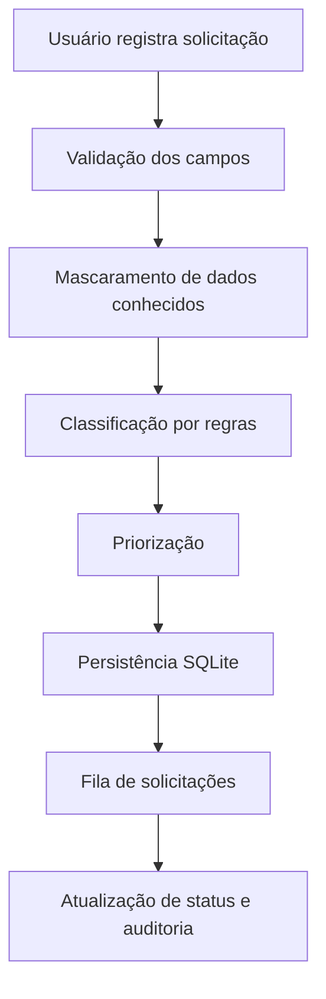

# 🛡️ SecureDesk
### Triagem inteligente. Atendimento mais seguro.

<p align="center"><strong>Uma central de suporte de TI que organiza solicitações, identifica prioridades e aplica cuidados de segurança desde a entrada dos dados.</strong></p>

<p align="center">


</p>

---

## ✦ Sobre o projeto

O **SecureDesk** é um protótipo de aplicação para triagem de solicitações de suporte de Tecnologia da Informação. A proposta é transformar relatos recebidos em chamados organizados, com categoria e prioridade sugeridas automaticamente.

Além do fluxo de atendimento, o projeto considera um ponto essencial: **informações sensíveis não devem ser tratadas como texto comum**. Por isso, a aplicação inclui validação de entradas, mascaramento de dados pessoais conhecidos, autenticação configurável e controles básicos contra abuso.

> O motor de triagem atual utiliza regras locais. A integração com modelos de IA é uma etapa futura, não uma funcionalidade já disponível.

## ✦ O problema

Solicitações de suporte podem chegar incompletas, sem categoria ou sem indicação clara de urgência. Isso dificulta a organização da fila e pode fazer com que incidentes importantes recebam atenção tarde demais.

O SecureDesk busca:
- Organizar solicitações em um único fluxo.
- Sugerir categorias e níveis de prioridade.
- Destacar relatos potencialmente relacionados à segurança.
- Reduzir a exposição acidental de dados pessoais comuns.
- Manter um registro básico das alterações de status.

## ✦ Funcionalidades implementadas

| Recurso | Descrição |
|---|---|
| Registro de chamados | Recebe solicitante, título e descrição com limites de tamanho. |
| Classificação automática | Sugere uma categoria por palavras-chave. |
| Priorização | Define prioridade baixa, média, alta ou crítica por regras explícitas. |
| Proteção de dados | Mascara e-mail, CPF e telefone reconhecidos antes de salvar. |
| Validação | Rejeita campos inválidos e propriedades inesperadas. |
| API autenticável | Suporta chave Bearer e sessão web assinada no servidor. |
| Login individual | Contas próprias com senha armazenada por hash PBKDF2 e sessão em cookie HttpOnly. |\n| Perfis de acesso | Perfis admin e agent; somente administradores gerenciam usuários. |
| Limite de requisições | Aplica rate limiting básico por endereço de origem. |
| Auditoria | Registra criação e mudanças de status. |
| Interface web | Permite registrar e acompanhar chamados em uma interface responsiva. |

## ✦ Fluxo de funcionamento



## ✦ Tecnologias e arquitetura

- **Interface:** HTML, CSS e JavaScript.
- **API:** Python com FastAPI e Pydantic.
- **Motor de triagem:** regras locais de classificação e prioridade.
- **Persistência:** SQLite com consultas parametrizadas.
- **Segurança:** validação, autenticação Bearer configurável, mascaramento e cabeçalhos HTTP.

## ✦ Estrutura do projeto

```text
secure-desk/
├── securedesk/
│   ├── config.py
│   ├── database.py
│   ├── main.py
│   ├── schemas.py
│   ├── security.py
│   └── triage.py
├── tests/
├── web/
│   ├── app.js
│   ├── index.html
│   └── styles.css
├── .env.example
├── .gitignore
└── pyproject.toml
```

## ✦ Como executar

**Requisito:** Python 3.11 ou superior.

1. Clone o repositório:
   ```bash
   git clone https://github.com/byvicky/secure-desk.git
   cd secure-desk
   ```
2. Crie e ative um ambiente virtual:
   ```bash
   python -m venv .venv
   # Linux/macOS
   source .venv/bin/activate
   # Windows PowerShell
   .venv\\Scripts\\Activate.ps1
   ```
3. Instale as dependências:
   ```bash
   pip install -e ".[dev]"
   ```
4. Inicie a aplicação:
   ```bash
   uvicorn securedesk.main:app --reload
   ```
5. Acesse:
   - Interface: http://127.0.0.1:8000
   - Health check: http://127.0.0.1:8000/api/health
   - Documentação (somente desenvolvimento): http://127.0.0.1:8000/docs

## ✦ Configuração de segurança

Copie `.env.example` para `.env`. Para habilitar autenticação obrigatória:

```env
SECUREDESK_ENV=production
SECUREDESK_API_KEY=uma-chave-longa-e-aleatoria
SECUREDESK_ADMIN_USERNAME=admin\nSECUREDESK_ADMIN_PASSWORD=uma-senha-forte-com-pelo-menos-12-caracteres
SECUREDESK_SESSION_SECRET=um-segredo-aleatorio-longo-para-assinar-sessoes
SECUREDESK_CORS_ORIGINS=
```

Gere uma chave forte:

```bash
python -c "import secrets; print(secrets.token_urlsafe(48))"
```

Na primeira inicialização, `SECUREDESK_ADMIN_USERNAME` e `SECUREDESK_ADMIN_PASSWORD` criam a conta administradora caso ainda não exista um administrador. A senha deve ter pelo menos 12 caracteres. Cada conta recebe usuário, hash PBKDF2 com salt individual e perfil `admin` ou `agent`. O administrador autenticado pode criar contas em `/api/users`; agentes não podem gerenciar usuários. O servidor cria uma sessão assinada em cookie `HttpOnly`, `SameSite=Strict` e `Secure` em produção. Clientes de API também podem usar `Authorization: Bearer <chave>`. Gere valores aleatórios fortes para `SECUREDESK_API_KEY` e `SECUREDESK_SESSION_SECRET`. Não coloque segredos no frontend nem faça commit do arquivo `.env`. Em desenvolvimento, sem senha de administrador configurada, o painel permanece aberto para uso local.

### Limitações conhecidas

Este é um protótipo educacional, não um serviço pronto para produção. O rate limiter é mantido em memória e serve apenas para uma única instância; a redação de dados usa padrões comuns e não garante detectar todo dado pessoal; ainda são necessários bloqueio específico contra tentativas automatizadas de login, recuperação e desativação de contas, auditoria vinculada ao usuário, HTTPS por proxy e revisão antes de uso real.

## ✦ Testes

```bash
pytest
```

## ✦ Roadmap

- [x] Estrutura inicial da API e interface.
- [x] Classificação e priorização baseadas em regras.
- [x] Mascaramento de identificadores comuns.
- [x] Validação de entrada e testes iniciais.
- [x] Login web com sessão assinada e cookie protegido.
- [x] Autenticação individual e perfis básicos de acesso.
- [ ] Integração opcional com LLM usando minimização de dados.
- [ ] Histórico detalhado e filtros na interface.
- [ ] Testes de integração e análise estática no CI.
- [ ] Revisão de segurança e documentação de implantação.

---

<p align="center">Desenvolvido como projeto de estudo em Python, APIs e segurança da informação.<br><strong>SecureDesk · by byvicky</strong></p>
